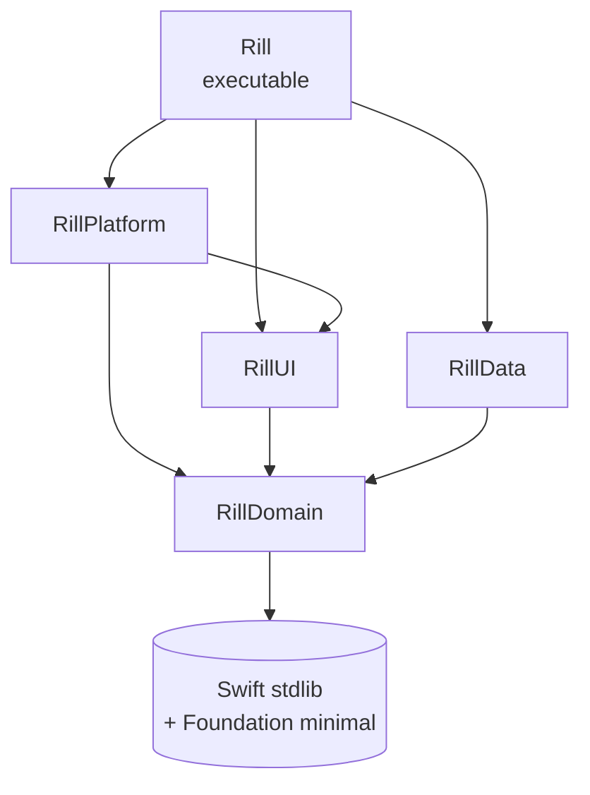
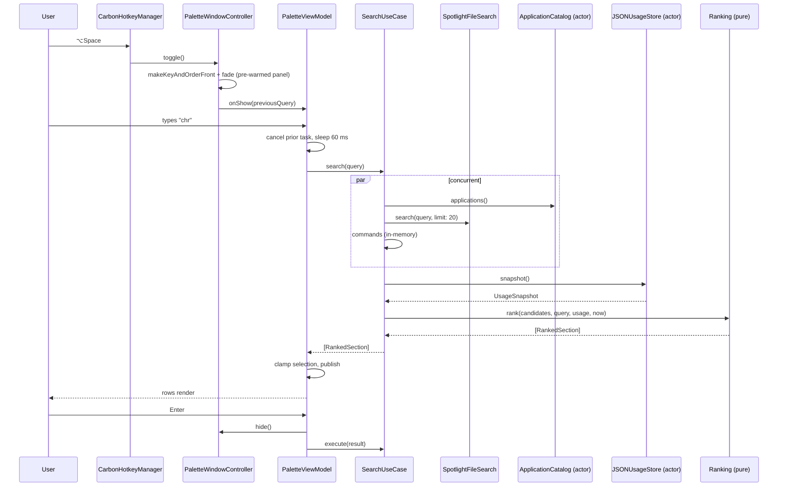

# Architecture

Companion to [`design.md`](design.md). This document is the binding contract for how the code is organised. `swift-standards.md` covers style; this covers structure.

---

## 1. Principles

1. **The dependency rule.** Source dependencies point inward. `RillDomain` knows nothing about AppKit, SwiftUI, SQLite, or HTTP.
2. **Ports and adapters.** Every side effect (file system, Spotlight, pasteboard, hotkey, clock, storage) is a protocol declared in Domain and implemented in an outer layer.
3. **One composition root.** Exactly one place constructs concrete types: `AppEnvironment.live()`. No singletons, no service locators, no `.shared` reads from feature code.
4. **Immutability by default.** Domain types are `struct` + `let`. Classes exist only for identity, observation, actor isolation, or framework subclassing.
5. **Make illegal states unrepresentable.** Enums over booleans, non-optional invariants, no `Optional` for "not loaded yet" where a state machine expresses it.
6. **Concurrency is part of the type.** Swift 6 language mode, no implicit `@unchecked Sendable`, actors for shared mutable state, `@MainActor` for UI.
7. **Testability is structural.** If a use case can't be tested without a Mac, its dependency is wrong.

## 2. Module graph

Xcode project with five targets and one test bundle, dependencies point inward. Swift 6 language mode on every target.



| Target         | Responsibility                                                                                      | May import                                                                                              |
| -------------- | --------------------------------------------------------------------------------------------------- | ------------------------------------------------------------------------------------------------------- |
| `RillDomain`   | Entities, use cases, ports, ranking, errors                                                         | Foundation only (`URL`, `Date`, `UUID`, `String(localized:)`). No AppKit, SwiftUI, Observation, SQLite. |
| `RillData`     | Port implementations: command registry, app catalogue, file search, frecency store, preferences     | Foundation, `NSMetadataQuery` (Foundation), `NSWorkspace`, SQLite/GRDB                                  |
| `RillUI`       | SwiftUI views + `@Observable` view models (presentation)                                            | SwiftUI, Observation, `RillDomain`                                                                      |
| `RillPlatform` | AppKit shell: `NSPanel`, global hotkey, activation, permissions, pasteboard, `NSHostingView` bridge | AppKit, Carbon, SwiftUI (for hosting), Domain                                                           |
| `Rill`         | `@main`, composition root, app delegate, wiring                                                     | everything                                                                                              |

**Enforced by the target graph and CI:** `RillDomain` does not link `AppKit`, `SwiftUI`, or `SQLite`; adding one requires editing the project, which is a reviewable diff. Because Swift auto-links a framework you `import`, the CI check `! grep -r "import AppKit\|import SwiftUI" RillDomain/` is what actually catches it.

Rationale for the `Platform` / `UI` split: SwiftUI cannot own a non-activating floating panel cleanly, and AppKit types (`NSPanel`, `NSWindow`) are not `Sendable`. Keeping both in one module makes the concurrency boundary mushy. The split puts the `@MainActor` boundary at a module edge.

### 2.1 Repository layout

Xcode project (`Rill.xcodeproj`, Xcode 27 JSON format) with five targets and one test target. No SwiftPM manifest — targets are project targets, folders are group folders on disk.

```
Rill/
├── Rill.xcodeproj/
├── design.md  architecture.md  swift-standards.md  AGENTS.md
├── Rill/                       Rill.app
│   ├── main.swift              NSApplication entry, no scene
│   ├── AppDelegate.swift       accessory policy, wiring
│   └── AppEnvironment.swift    composition root: live port construction
├── RillDomain/                 .framework
│   ├── Entities/               SearchQuery, SearchResult, RankedSection, UsageSnapshot, Hotkey
│   ├── Ports/                  CommandProviding, ApplicationCataloguing, FileSearching,
│   │                           UsageStoring, PreferencesStoring, HotkeyRegistering,
│   │                           Clock, ActionPerforming, PasteboardWriting
│   ├── UseCases/               SearchUseCase, ExecuteResultUseCase, LoadSuggestionsUseCase
│   ├── Ranking/                Ranking.swift, MatchScore.swift, Frecency.swift, RankingTuning.swift
│   └── Section.swift
├── RillData/                   .framework
│   ├── Commands/               CommandRegistry, BuiltInCommands
│   ├── Applications/           ApplicationCatalog
│   ├── Files/                  SpotlightFileSearch
│   ├── Usage/                  JSONUsageStore (actor)
│   └── Preferences/            UserDefaultsPreferencesStore
├── RillUI/                     .framework
│   ├── Palette/                PaletteView, PaletteViewModel, SearchField, ResultRow, SectionHeader
│   └── Settings/               SettingsView, HotkeyRecorderView
├── RillPlatform/               .framework
│   ├── Window/                 PalettePanel, PaletteWindowController, PanelPositioner
│   ├── Hotkey/                 CarbonHotkeyManager
│   ├── System/                 AccessibilityService, SystemActionPerformer,
│   │                           ActivationPolicyController, LaunchAtLogin
│   └── Bridge/                 PaletteHostingView
└── RillDomainTests/            .xctest (Swift Testing)
```

## 3. Domain model

```swift
// RillDomain/Entities

public struct SearchQuery: Sendable, Hashable {
    public enum Mode: Sendable, Hashable {
        case root                 // empty field: suggestions
        case text(String)         // ordinary query
        case scoped(Scope, String) // "f " file scope, "a " app scope
    }
    public var raw: String
    public var mode: Mode
    public var tokens: [String] { /* normalized, diacritic-folded */ }
}

public struct RankedSection: Identifiable, Sendable {
    public let section: Section
    public let results: [SearchResult]   // already ordered
}

public enum Section: String, Sendable, CaseIterable {
    case favorites, suggestions, commands, applications, files, fallback
}
```

```swift
// RillDomain/Ports — every port is Sendable and async-capable

public protocol FileSearching: Sendable {
    func search(_ query: SearchQuery, limit: Int) async throws -> [SearchResult]
}

public protocol ApplicationCataloguing: Sendable {
    func applications() async -> [SearchResult]          // cached; refreshed in background
}

public protocol CommandProviding: Sendable {
    var commands: [SearchResult] { get }                 // synchronous, in-memory, Sendable
}

public protocol UsageStoring: Sendable {
    func snapshot() async -> UsageSnapshot
    func record(_ id: SearchResult.ID, at date: Date) async
    func toggleFavorite(_ id: SearchResult.ID) async
}

public protocol ActionPerforming: Sendable {
    func perform(_ action: ActionDescriptor) async throws
}

public protocol HotkeyRegistering: Sendable {
    func register(_ hotkey: Hotkey) async throws -> HotkeyToken
    func unregister(_ token: HotkeyToken) async
}
```

Rules:

- Ports return **domain types only** (`SearchResult`, not `NSRunningApplication`).
- Ports are `Sendable` so they can be called from any isolation domain. Implementations are actors or immutable structs — never a `@MainActor class` with mutable state.
- A port method that can fail uses `throws` with a **typed** error when the set is closed (`throws(FileSearchError)`). Untyped `throws` where the set is genuinely open (framework errors).

### 3.1 Use cases

One type per use case, a `struct` with injected ports, one `callAsFunction`:

```swift
public struct SearchUseCase: Sendable {
    let commands: CommandProviding
    let applications: ApplicationCataloguing
    let files: FileSearching
    let usage: UsageStoring

    public func callAsFunction(
        _ query: SearchQuery,
        limit: Int = 40
    ) async -> [RankedSection]
}
```

`SearchUseCase` owns orchestration only: fan out concurrently, merge, hand to the pure `Ranking`. It contains no debounce, no cancellation management, no UI state — those belong to the view model (debounce is a presentation concern: it depends on typing speed) and to `async let`/`TaskGroup` (cancellation is structural).

```swift
// Sketch of the fan-out. Scope-dependent: skip file search for scoped app queries.
public func callAsFunction(_ query: SearchQuery, limit: Int = 40) async -> [RankedSection] {
    async let appMatches = applications.applications()
    async let fileMatches: [SearchResult] = {
        guard query.wantsFiles else { return [] }
        return (try? await files.search(query, limit: 20)) ?? []
    }()

    let (apps, files) = await (appMatches, fileMatches)
    let candidates = commands.commands + apps + files + fallbackCommands(for: query)
    let usage = await usage.snapshot()

    return Ranking.rank(candidates, query: query, usage: usage, now: Clock.now())
}
```

Note `try?`: a failing file search degrades the palette; it must never empty it. Log the error, keep the other sections.

## 4. Concurrency model

Swift 6 language mode everywhere (`SWIFT_VERSION = 6.0` on every target). The app, UI and platform targets use `SWIFT_DEFAULT_ACTOR_ISOLATION = MainActor`, so UI code needs no annotation and non-UI code is explicitly `nonisolated` or an actor. `RillDomain` and `RillData` use `SWIFT_DEFAULT_ACTOR_ISOLATION = nonisolated` — domain types must not be implicitly main-actor bound.

| State                                                             | Owner                                     | Why                                                                                                                                                                                |
| ----------------------------------------------------------------- | ----------------------------------------- | ---------------------------------------------------------------------------------------------------------------------------------------------------------------------------------- |
| Palette visibility, query text, selection index, visible sections | `@MainActor @Observable PaletteViewModel` | It is UI state. Anything else causes hop-per-keystroke.                                                                                                                            |
| Installed app catalogue                                           | `actor ApplicationCatalog`                | Mutated by FSEvents refresh, read by searches.                                                                                                                                     |
| Frecency/usage data                                               | `actor JSONUsageStore`                    | Serialised read-modify-write to disk.                                                                                                                                              |
| File search                                                       | `@MainActor SpotlightFileSearch`          | `NSMetadataQuery` is run-loop driven and thread-affine; wrapping it in an actor means hopping to MainActor inside anyway. MainActor + debounce + cancellation is the honest model. |
| Hotkey event source                                               | `@MainActor CarbonHotkeyManager`          | Carbon events arrive on the main run loop.                                                                                                                                         |
| Ranking, match scoring, frecency math                             | `nonisolated` free functions              | Pure, synchronous, trivially parallel.                                                                                                                                             |

Hard rules:

- **No `Task.detached`** in feature code. Structured concurrency only; a detached task has no cancellation relationship to the palette.
- **No `@unchecked Sendable`** without a `// SAFETY:` comment naming the invariant. Expected count in v1: zero.
- **No `DispatchQueue`** in new code. `NSMetadataQuery` uses the main run loop; everything else is `async`.
- **Cancellation is checked, not assumed.** File search calls `try Task.checkCancellation()` between result batches.
- Value types crossing isolation boundaries are `Sendable` structs. `NSImage`/`NSRunningApplication` never cross — only `IconRef` (a value describing how to load an icon) does.
- Typed throws where the error set is closed; `throws(SearchError)` keeps call sites honest.

### 4.1 Debounce + cancellation

```swift
@MainActor @Observable
final class PaletteViewModel {
    private var searchTask: Task<Void, Never>?

    var query: String = "" {
        didSet { scheduleSearch() }
    }

    private func scheduleSearch() {
        searchTask?.cancel()
        let query = SearchQuery(raw: query)
        guard query.mode != .root else {
            sections = suggestions
            return
        }
        searchTask = Task { [weak self] in
            // 60 ms: below the perceived-latency floor, above one keystroke interval
            try? await Task.sleep(for: .milliseconds(60))
            guard !Task.isCancelled, let self else { return }
            let sections = await searchUseCase(query)
            guard !Task.isCancelled else { return }
            self.sections = sections
        }
    }
}
```

Two properties this must preserve: results never flash out of order (a cancelled task never writes), and the selection index is clamped when the section list shrinks.

## 5. Presentation layer

### 5.1 Unidirectional-ish flow, without a framework

`PaletteView` (SwiftUI, stateless) renders `PaletteViewModel` (`@MainActor @Observable`). Inputs are methods (`moveSelection`, `activate`, `clear`), state is `private(set)` properties. No bindings into the model, no business logic in the view body.

This is deliberately not TCA. Rationale in §10 (ADR-002).

### 5.2 Views

- `PaletteView` — search field + `ScrollView { LazyVStack }` of sectioned rows.
- Use `@Observable` + `@State`/`@Environment` for propagation. No `ObservableObject`, no `@Published`.
- Row identity is `SearchResult.ID` so SwiftUI diffs instead of rebuilding.
- Icons load asynchronously per row and are cached in `NSCache` inside `RillUI`'s `IconLoader` — not in the domain, not in the row view.

### 5.3 Why AppKit owns the window

SwiftUI's `WindowGroup`/`Window` scenes are activation-policy-driven: they bring the app forward, they appear in the window menu, they can't be made key without activating. A launcher needs the opposite. So:

```swift
@MainActor
final class PalettePanel: NSPanel {
    override var canBecomeKey: Bool { true }
    override var canBecomeMain: Bool { false }
}

// configuration
panel.styleMask = [.nonactivatingPanel, .borderless, .fullSizeContentView]
panel.level = .floating
panel.isFloatingPanel = true
panel.hidesOnDeactivate = false
panel.collectionBehavior = [.canJoinAllSpaces, .fullScreenAuxiliary, .ignoresCycle]
panel.isOpaque = false
panel.backgroundColor = .clear
panel.becomesKeyOnlyIfNeeded = false
```

`PaletteWindowController` owns the panel, hosts `PaletteView` in an `NSHostingView`, and pre-warms it at launch: the panel and view hierarchy exist, are laid out once, and stay hidden (`alphaValue = 0`). Showing is `makeKeyAndOrderFront` + animate alpha — no SwiftUI graph construction on the hot path. That is the mechanism behind the ≤ 80 ms budget.

### 5.4 Activation policy — the app must never "come forward"

Requirement (see `design.md` §5.3): the previously active app keeps its menu bar and Dock highlight while the palette is open. The launcher is an overlay, not an app switch.

```
Info.plist: LSUIElement = YES
            ↑ the app has no Dock tile and no menu bar, ever

Palette show path:
            panel.makeKeyAndOrderFront(nil)
            ↑ becomes key, app stays inactive, previous app keeps activation
            (no NSApp.activate anywhere)
```

`.nonactivatingPanel` is what makes the panel able to take keystrokes while the app is inactive:

```swift
panel.styleMask.insert(.nonactivatingPanel)
panel.becomesKeyOnlyIfNeeded = false
// and PalettePanel overrides canBecomeKey -> true, canBecomeMain -> false
```

Activation policy is a **refcounted override**, not a toggle, because Settings may open while another auxiliary window is already open:

```swift
@MainActor
final class ActivationPolicyController {
    private var regularOverrides = 0

    func acquireRegular() {
        regularOverrides += 1
        guard regularOverrides == 1 else { return }
        NSApp.setActivationPolicy(.regular)
    }

    func releaseRegular() {
        regularOverrides -= 1
        guard regularOverrides == 0 else { return }
        NSApp.setActivationPolicy(.accessory)
    }
}
```

Only `SettingsWindowController` and the About panel call `acquireRegular()`/`releaseRegular()`. Nothing else in the codebase may touch `NSApp.setActivationPolicy` or `NSApp.activate`. This mirrors Raycast's own `NSApplication+ActivationPolicy.swift` (`makeAccessoryPolicyOverrideToken(restoreRegularOnRelease:)`), which exists for the same reason.

Why not just call `setActivationPolicy(.accessory)` at launch instead of using `LSUIElement`? Because it must be true _before_ the app finishes registering with the window server; doing it later leaves a one-frame Dock flash at login. `LSUIElement` is the declarative form of the same fact. (We may still call `setActivationPolicy(.accessory)` defensively in `applicationDidFinishLaunching` to recover from a stale override — idempotent and cheap.)

Failure modes this design is defending against:

| Symptom                                     | Cause                                                                                       |
| ------------------------------------------- | ------------------------------------------------------------------------------------------- |
| Dock icon flashes on launcher open          | `NSApp.activate(_:)` on the show path, or `.regular` left set                               |
| Launcher appears in ⌘Tab                    | `LSUIElement` missing or overridden to `.regular`                                           |
| Menu bar changes to the launcher's          | App is active; a scene-based window stole activation                                        |
| Search field won't accept keystrokes        | `canBecomeKey` false or `.nonactivatingPanel` missing — **not** a reason to call `activate` |
| Dock icon disappears while Settings is open | Non-refcounted policy toggle                                                                |

### 5.5 Hotkey

Carbon `RegisterEventHotKey` — the only global-hotkey API that needs no Accessibility grant and doesn't install an event tap:

```swift
var ref: EventHotKeyRef?
let id = EventHotKeyID(signature: fourCharCode("LMEN"), id: 1)
let status = RegisterEventHotKey(
    keyCode, modifiers, id, GetApplicationEventTarget(), 0, &ref
)
```

The handler is a C function pointer installed with `InstallEventHandler`; it may not capture context, so it posts to a `@MainActor` bridge through a static token→manager table (the one justified piece of static state, documented). Hotkey conflicts surface as a `HotkeyError.unavailable` in Settings rather than a silent failure.

## 6. Execution

`ActionDescriptor` is data:

```swift
public enum ActionDescriptor: Sendable, Hashable {
    case openApplication(bundleID: String)
    case openURL(URL)
    case revealInFinder(URL)
    case openFile(URL)
    case copyToPasteboard(String)
    case runSystemCommand(SystemCommandID)
    case custom(id: String)   // resolved by the registry; extension seam
}
```

`ExecuteResultUseCase` (Domain) resolves descriptor → `ActionPerforming` port call, and records usage. Order matters:

1. Hide the palette (≤ 50 ms, no waiting on the action).
2. `await performer.perform(action)`.
3. `await usage.record(id, at: now)`.
4. On failure: re-show the palette with an inline error row? **No** — show a non-blocking toast via `NSUserNotification`-free path (`UNUserNotificationCenter` needs permission); simplest correct behaviour is to log and beep, and surface the error in Settings > Diagnostics. Decided: log + `NSSound.beep()`, no modal.

`SystemActionPerformer` lives in `RillPlatform` because it touches `NSWorkspace`, `AXUIElement`, and `NSAppleScript`. It is the only type that knows about Accessibility, and it checks `AXIsProcessTrusted()` per call rather than caching, so a mid-session grant works.

## 7. Data flow, end to end



## 8. Persistence

| Data                                                | Store                                                                                                    | Location                                        |
| --------------------------------------------------- | -------------------------------------------------------------------------------------------------------- | ----------------------------------------------- |
| Preferences (hotkey, scopes, appearance)            | `UserDefaults`, behind `PreferencesStoring` port                                                         | standard defaults domain                        |
| Frecency (id → count, lastUsed, favorite, pinOrder) | Single JSON snapshot, atomic write-through on every record (`write(to:options:.atomic)`) | `~/Library/Application Support/Rill/usage.json` |
| Application catalogue                               | Derived, rebuilt at launch + FSEvents                                                                    | in memory only                                  |

No SQLite in v1. Frecency is thousands of rows at most, and a JSON snapshot reloads in single-digit milliseconds.

`shortcut: JSON snapshot, not a database — revisit if history exceeds ~50k entries or we add clipboard history, at which point GRDB replaces JSONUsageStore behind the same port.`

Storage stays behind `UsageStoring`, so that swap touches one file.

## 9. Testing strategy

Swift Testing (`import Testing`), no XCTest except where UI automation forces it.

| Layer                               | How                                                                                       | What it proves                                   |
| ----------------------------------- | ----------------------------------------------------------------------------------------- | ------------------------------------------------ |
| `Ranking`, `MatchScore`, `Frecency` | Pure functions, parameterised `@Test(arguments:)`                                         | Scores, ordering stability, section invariants   |
| Use cases                           | Injected fakes (`FakeFileSearch`, `StubApplications`, `InMemoryUsageStore`, `FixedClock`) | Fan-out, partial failure tolerance, limits       |
| Data adapters                       | Real filesystem in a temp dir; `NSMetadataQuery` against a fixture folder                 | File search predicate correctness, atomic writes |
| Platform                            | Mostly untested by design (AppKit wrappers). `<10 %` and no logic.                        | —                                                |
| End-to-end                          | One XCUITest: hotkey → type → Enter → app opened                                          | The loop actually works                          |
| Performance                         | `PerformanceTests` measuring show latency and query latency with `ContinuousClock`        | Budgets in `design.md` §4.6                      |

Test rules:

- Fakes live in `Tests/Fakes` and are shared across test targets. No protocol-mocking frameworks.
- No `sleep` in tests. Inject `Clock`; use `TestClock`/manual advancement.
- Each test asserts one behaviour and is named as a sentence without the word "test": `@Test func `empty query falls back to suggestions`()`.
- Golden-file tests for ranking: a fixture list + query → expected ordered IDs. Updating the golden file is a reviewable diff, which is the point.

## 10. Decisions (ADR log)

**ADR-001 — Clean Architecture with ports/adapters, not layered MVC.**
Consequence: more types, one extra module boundary. Payoff: ranking and use cases are testable without a Mac window, and the file-search implementation can be replaced (own indexer later) without touching UI.

**ADR-002 — Plain `@Observable` view models instead of The Composable Architecture.**
TCA is excellent but brings a reducer/action vocabulary, a `Store` type, and a 250 ms+ mental tax per feature for an app whose state is one screen, one list, one selection. We keep the part that matters (unidirectional input methods, injected dependencies, exhaustive tests) and skip the framework. Revisit if the palette grows nested navigation.

**ADR-003 — Single process, no plugin runtime.**
Raycast's Node backend exists to host third-party extensions safely and cross-platform. We have no extensions in v1. A second runtime would cost 20+ MB and a supervisor for zero user value today.

**ADR-004 — Carbon hotkey over `CGEventTap`.**
Carbon's `RegisterEventHotKey` requires no permission, no event tap, and cannot be used to keylog. `CGEventTap` would trip Input Monitoring prompts and looks like spyware. Deprecated-but-functional is the right trade here; wrap it in `HotkeyRegistering` so it can be replaced in one file.

**ADR-005 — `NSMetadataQuery`, not our own index, for files in v1.**
macOS already indexes the disk. Building a content indexer (Raycast does) is a multi-month subsystem. `NSMetadataQuery` gives filename/metadata search on day one; `FileSearching` is the seam for a real indexer later.

**ADR-006 — Non-sandboxed, Developer ID distribution.**
Forced by Accessibility + filesystem-wide metadata search. Accepted cost: no Mac App Store.

**ADR-007 — `LSUIElement` + `.nonactivatingPanel` + a refcounted policy override, instead of "activate and hide the dock icon".**
A launcher that activates changes the menu bar, the Dock highlight, and ⌘Tab order — three visible side effects for one keystroke. Keeping the app permanently accessory and never activating means the palette can be summoned hundreds of times a day without the window server ever noticing. The cost is that any real window (Settings) must explicitly borrow `.regular` activation, hence the refcount. Details: `design.md` §5.3 and §5.4 in this document.

## 11. Known shortcuts

Each is a deliberate deferral with an upgrade path, and each appears as a `shortcut:` comment at the code site.

| Shortcut                                                  | Upgrade trigger                                                                                   |
| --------------------------------------------------------- | ------------------------------------------------------------------------------------------------- |
| `NSMetadataQuery` for files (no content index)            | Search quality complaints, or > 150 ms file latency                                               |
| JSON usage snapshot                                       | > ~50k rows, or clipboard history added                                                           |
| Write-through usage writes (no batching)                  | Executions become automated or batched                                                            |
| Application scan one level per root                       | Missing apps reported inside bundle-style subdirectories                                          |
| No extension/plugin seam beyond `ActionDescriptor.custom` | When a second-party command source is needed                                                      |
| English-only strings                                      | Before any non-English user feedback — though all strings already go through `String(localized:)` |
| No crash reporting                                        | Public distribution                                                                               |

## 12. Definition of done (per feature)

1. Port + adapter + use case exist; no AppKit type leaks into Domain.
2. Tests cover the branch that can fail, not the happy path only.
3. `swift build` and `swift test` are warning-free in Swift 6 mode.
4. Latency budgets unaffected, or the diff explains why.
5. Keyboard-only path works; VoiceOver label present on new UI.
6. Dock and menu bar never change when the palette opens (manual check, every PR touching `RillPlatform`).
7. No new `// swiftlint:disable`, no `!`, no `try!`, no `Task.detached`.
